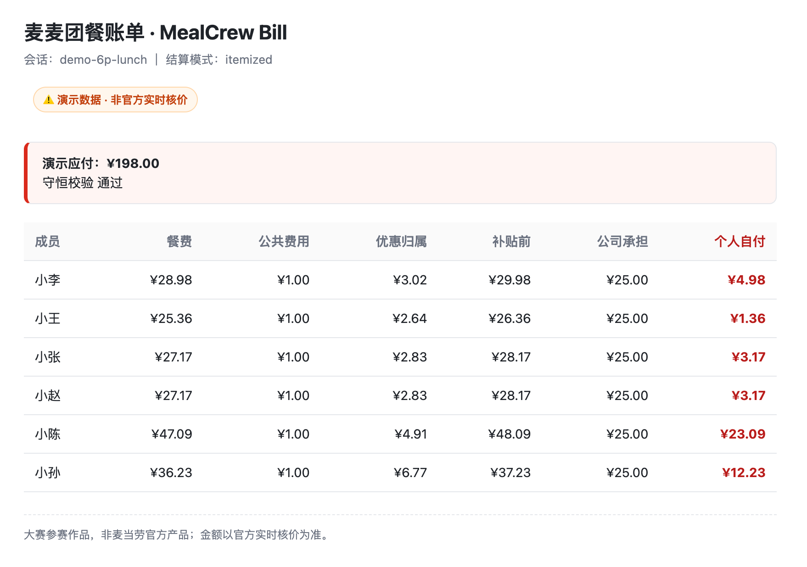

# 麦麦团餐助手 · Maimai MealCrew

> 一群人吃麦麦，需求一起理，优惠一起算，账单一次清。
>
> **多人需求整理 · 灵活结算 · 改单重算**

同事拼午餐、团队加班餐、朋友一起点外卖——把大家的需求交给麦麦团餐助手，整理谁点什么、谁吃共享餐，再把优惠、配送费和公司补贴算进同一张按人账单。

**公司补多少、每人付多少、改餐后差多少，都有账可看。**

[看账单效果](#一张账单把钱算清楚) · [试跑演示](#一分钟试跑) · [安装 Skill](docs/installation.md) · [了解 MCP 接入](MCP_INTEGRATION.md)

## 一张账单，把钱算清楚

下面是一份 **6 人午餐的离线演示账单**：有个人餐品、共享餐、优惠和配送费，公司每人最多补贴 25 元，剩余由个人承担。



| 一起吃饭 | 本单应付 | 公司承担 | 个人自付合计 |
|---|---|---|---|
| 6 人 | **¥198.00** | **¥150.00** | **¥48.00** |

小李自付 **4.98 元**，小王自付 **1.36 元**；各自拿到了多少优惠、分到了多少公共费用，也在同一行里。组织者不用再逐个解释“为什么你要付这个数”。

*截图使用合成数据，展示账单呈现与本地结算效果，不代表当前菜单、实时价格或实际可用优惠。*

## 从群里的点餐消息，到每个人的账

### 先整理：谁点什么，谁一起吃

把分散的点餐消息交给助手，整理成员、餐品、数量和共享关系；有歧义时先确认，再进入核价与结算。

> “我们 6 个人点麦当劳，公司每人补贴 25 元。小李和小王各点自己的套餐，薯条大家一起吃，配送费平摊。”

### 再结算：优惠、公共费用、餐补一起算

个人餐品按归属计算，共享餐按参与者分摊；优惠核减后，再按约定分配公共费用和补贴。结果可以导出成 **Markdown、JSON 或单文件 HTML 账单**。

> “按各自点的餐算，共享餐均分，公司补贴后，列出每个人还需要付多少。”

### 有人改餐：看新账，也看差额

增减人、换餐、改数量后，重新计算方案，并对比上一版的总额与逐人自付变化。真实价格变化需要由宿主重新取得官方报价。

> “小李换大份，跟上一版比差多少钱？”
>
> “小王不来了，重新核价，看看优惠和每个人的钱有什么变化。”

## 适合谁用

- **拼午餐的同事**：各点各的，共享餐和配送费也能一起分。
- **加班餐的组织者**：餐费与公司补贴放在一张账单里核算。
- **朋友聚餐、活动订餐的发起人**：整理多人需求，改餐后对比差额。

这里的“团餐”泛指多人用餐；企业团餐专属渠道和优惠需以官方接口与账号权限为准。

## 一分钟试跑

下载或克隆本仓库，在仓库根目录运行（需要 **Python 3.9+**，无需安装第三方依赖）：

```bash
python3 skill/maimai-mealcrew/scripts/mealcrew.py demo --output ./demo_out
```

打开生成的 `demo_out/demo_report.html`，即可查看上面的六人账单；同目录还会保存 `demo_result.json`，终端会打印 Markdown 摘要。

**离线演示无需 Token。** 想通过自然语言使用，先将 [麦麦团餐助手 Skill](skill/maimai-mealcrew/) 安装到支持 Agent Skill 的宿主，再参考 [安装指南](docs/installation.md) 配置麦当劳 MCP。

## 团餐组织者的四个省心时刻

| 想省心的事 | 麦麦团餐助手帮你做什么 |
|---|---|
| **需求好整理** | 个人餐、共享餐、数量与参与者整理到一起，少翻群消息，少漏一份餐 |
| **优惠算得清** | 在相同用餐需求下比较方案应付，列清优惠归属和公共费用，让每个人知道钱怎么算 |
| **补贴好分配** | 按人补贴或全单补贴，明确谁能补、补哪些费用，直接列出公司承担与个人自付 |
| **改餐能重算** | 有人退出、换餐、改数量后重新核价与分账，对比上一版总额和逐人差额 |

最后得到一份可分享、可打印的账单：**餐费、优惠、配送费、公司补贴、个人自付，一张表说清楚。**

## 使用说明与开发资料

麦麦团餐助手以 **Agent Skill** 交付：宿主负责对话、商品查询和官方 MCP 核价，Python 标准库脚本负责本地金额计算与账单生成。公司补贴是内部结算规则，不改变麦当劳应收金额。

| 想了解什么 | 从这里开始 |
|---|---|
| 安装 Skill、配置宿主与 Token | [安装指南](docs/installation.md)、[MCP 配置示例](mcp-config.example.json) |
| 运行演示、查看输入与输出 | [演示指南](docs/demo-guide.md)、[样例数据](skill/maimai-mealcrew/examples/demo_session.json) |
| Skill 触发与工作流程 | [SKILL.md](skill/maimai-mealcrew/SKILL.md) |
| 官方 MCP 的职责与调用流程 | [MCP 接入说明](MCP_INTEGRATION.md) |
| 金额、需求与报价的数据格式 | [数据契约](skill/maimai-mealcrew/references/data-contract.md) |

<details>
<summary>开发者入口：命令行、核价与测试</summary>

以下命令均在仓库根目录运行。对话中的需求提取由宿主完成，`normalize` 接收结构化 JSON。

```bash
# 归一化样例需求
python3 skill/maimai-mealcrew/scripts/mealcrew.py normalize \
  --input skill/maimai-mealcrew/examples/demo_session.json --output session.json

# 离线结算并导出 HTML
python3 skill/maimai-mealcrew/scripts/mealcrew.py settle \
  --session session.json --mode demo --render html --output bill.html

# 真实结算：quote.json 应由宿主官方核价后归一化生成
python3 skill/maimai-mealcrew/scripts/mealcrew.py settle \
  --session session.json --mode real --quote quote.json --render md

# 先准备新需求，由宿主重新核价
python3 skill/maimai-mealcrew/scripts/mealcrew.py revise \
  --session session.json --changes changes.json --mode real --prepare --output prepared.json

# 真实改单：需提供原方案与新方案分别核价的结果
python3 skill/maimai-mealcrew/scripts/mealcrew.py revise \
  --session session.json --changes changes.json --mode real \
  --quote-old quote-old.json --quote-new quote-new.json

# 比较已确认相同需求的多个真实报价
python3 skill/maimai-mealcrew/scripts/mealcrew.py compare --plans plans.json --mode real

# 本地自检与测试（不替代真实 MCP 联调）
python3 skill/maimai-mealcrew/scripts/mealcrew.py doctor
python3 -m unittest discover -s tests -v

# 生成可导入的 Skill ZIP
python3 build_dist.py
```

真实模式只接受来源为 MCP 且与当前会话、核价输入指纹匹配的报价；详细字段和两阶段改单见 [MCP 工作流](skill/maimai-mealcrew/references/mcp-workflow.md)。`settle`、`revise` 和 `render` 对账失败均阻止正式输出。

子命令：`normalize` / `candidates` / `settle` / `revise` / `compare` / `render` / `demo` / `doctor`。

</details>

## 关于本项目

本项目是 [麦当劳程序员节创意开发大赛](https://github.com/M-China/mcd-developer-innovation-challenge) 的参赛作品，**非麦当劳官方产品**。餐品、价格、优惠和供应状态以官方渠道实时结果为准。

- Token 通过宿主设置或环境变量提供，不写入公开文件。
- 领取优惠券、下单、取消等操作需要用户明确确认；核价与分账不代表已经下单或付款。
- 官方缺少逐项优惠归因时，本地分摊需标明依据并由组织者确认。
- 代码采用 [MIT 许可证](LICENSE)；参赛声明见 [CONTEST_DECLARATION.md](CONTEST_DECLARATION.md)。

如果你也经常组织多人点餐，欢迎试跑演示、提交使用反馈，或 **Star 收藏这个项目**。
