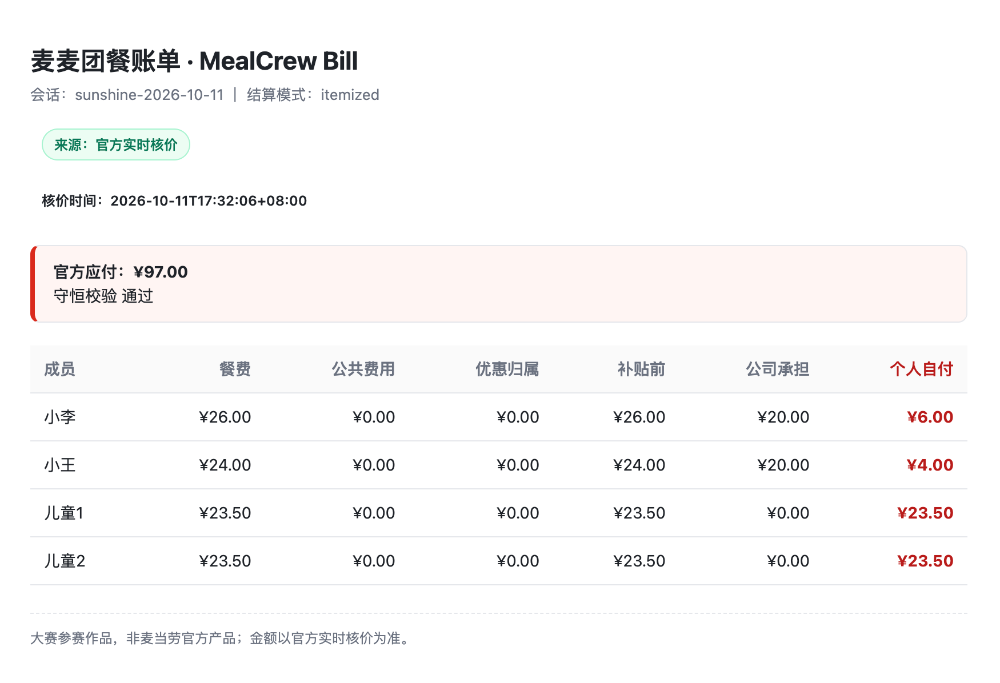
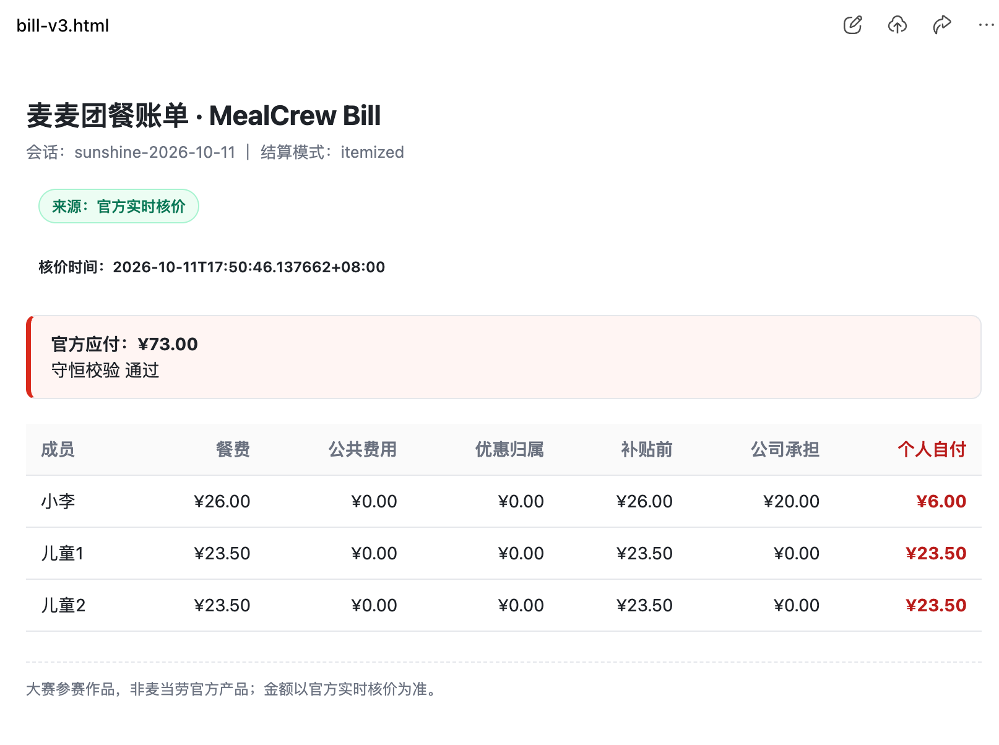

# 真实使用案例：多人核价、餐补分账与减人重算

2026 年 10 月 11 日，使用 WorkBuddy 与已配置的 `mcd-mcp`，在阳光小镇餐厅到店自取场景完成原餐单核价与减人后的重新核价。记录依据参赛者提供的 WorkBuddy 会话截图和本地输出文件；具体宿主版本未在截图中显示。

## 原方案：四人用餐

需求为两位成人、两位儿童，总预算100元。成人每人补贴20元，儿童不补贴，补贴不含公共费用。

会话结果记录的工具链路为：

`query-nearby-stores` → `query-meals` → `query-meal-detail` → `query-store-coupons` → `calculate-price` → 本地结算脚本。

菜单匹配后餐单为巨无霸26元、板烧鸡腿堡24元、两份儿童套餐各23.5元。门店券返回空列表；本单无优惠、无公共费用。

- 原版核价时间：2026-10-11 17:32:06（北京时间）。
- 官方应付：97元。
- 本地补贴分配：公司承担40元，个人自付合计57元。
- 逐人自付：小李6元、小王4元、两位儿童各23.5元。

## v3：小王退出

在原方案基础上移除小王、他的板烧鸡腿堡及其补贴资格，再取得新报价，完成重算。

- 新核价时间：2026-10-11 17:50:46.137662（北京时间）。
- 官方应付：73元，比原方案减少24元。
- 公司承担20元，个人自付合计53元。
- 小李和两位儿童的个人自付不变；小王原自付4元从新账单中移除。
- 差额记录识别商品删除、人员减少与补贴规则变化，要求重新确认；旧确认已清除。

## 核验结果

原版 `40 + 57 = 97`；v3 `20 + 53 = 73`。两份归一化报价与各自需求指纹匹配，明细对账、守恒及差额复算通过，HTML 与当前脚本重新生成结果一致。

v2 是同餐单再次核价，金额不变；实际减人案例是 v3。本次证明无券场景的真实核价与餐补分账，不将合成优惠当作真实生效的券。

会话截图见 [WorkBuddy 上下文](../workbuddy.md)。本地原始会话目录不提交 Git；公开材料未包含 Token、会员账户 ID、手机号或详细地址。当前材料未单独导出官方工具的完整原始请求与响应，核价来源依据实际会话记录及其保存输出。
