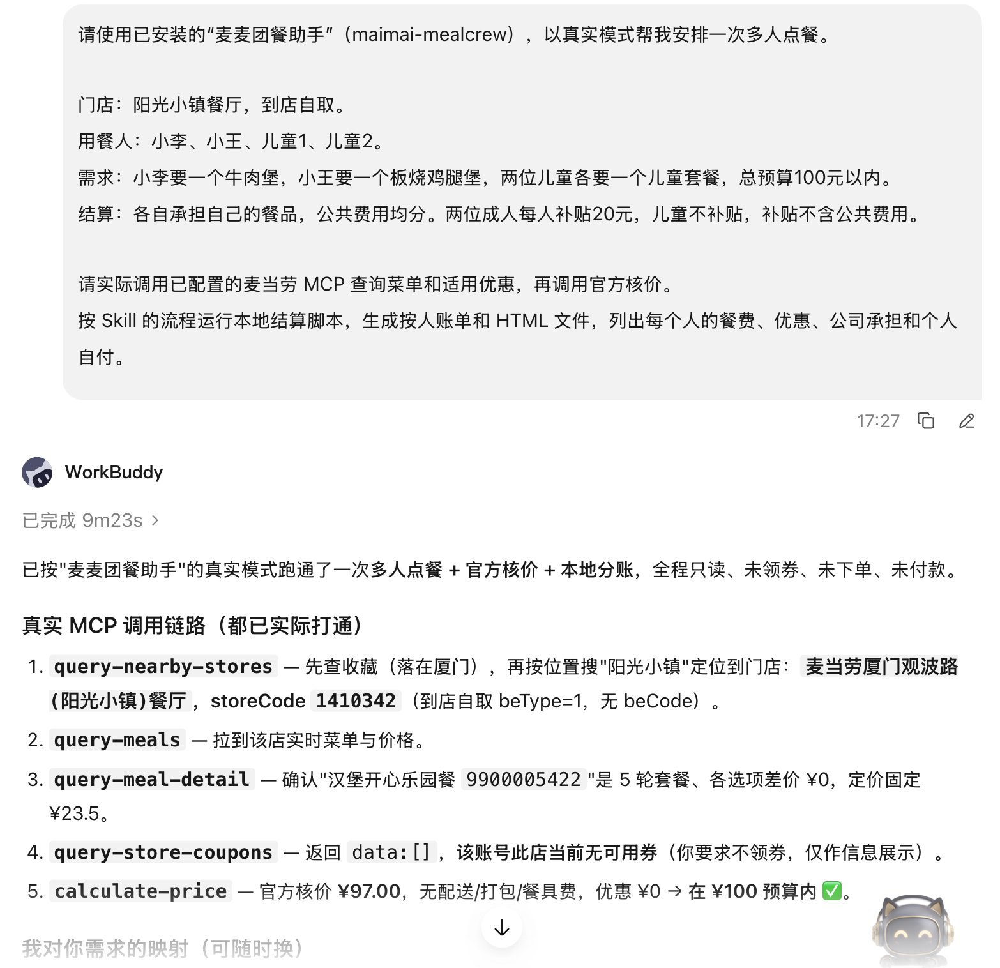

# WorkBuddy 使用上下文：麦麦团餐助手

2026 年 10 月 11 日，参赛者在 WorkBuddy 中使用麦麦团餐助手的工作流，完成阳光小镇餐厅的一次多人选餐、麦当劳 MCP 核价、本地餐补分账和减人重算。本文根据实际会话截图与保存的会话文件整理，非模拟对话。宿主具体版本未在截图中显示。

## 真实使用需求

用户在 WorkBuddy 中明确要求使用 `maimai-mealcrew` 真实模式：

> 门店：阳光小镇餐厅，到店自取。用餐人：小李、小王、儿童1、儿童2。
> 小李要一个牛肉堡，小王要一个板烧鸡腿堡，两位儿童各要一个儿童套餐，总预算100元以内。
> 各自承担自己的餐品，公共费用均分。两位成人每人补贴20元，儿童不补贴，补贴不含公共费用。
> 实际调用麦当劳 MCP 查询菜单和适用优惠，再调用官方核价，运行本地结算脚本，生成按人账单和 HTML 文件。

初次执行时，WorkBuddy 的 Skill 加载工具未自动发现项目技能；会话明确说明此情况，并继续按此前已读取的 Skill 工作流执行。因此本记录证明 WorkBuddy 中的工作流运行，不将这次加载失败描述成自动发现成功。

## WorkBuddy 运行结果

会话结果记录了 `query-nearby-stores`、`query-meals`、`query-meal-detail`、`query-store-coupons` 和 `calculate-price`：定位门店、读取菜单、确认儿童套餐、查询优惠，再完成官方核价。

实际餐单为巨无霸26元、板烧鸡腿堡24元、两份汉堡开心乐园餐各23.5元。门店券查询结果为空，本单优惠和公共费用均为0。

| 用餐人 | 餐费 | 公司补贴 | 个人自付 |
|---|---:|---:|---:|
| 小李 | ¥26.00 | ¥20.00 | ¥6.00 |
| 小王 | ¥24.00 | ¥20.00 | ¥4.00 |
| 儿童1 | ¥23.50 | ¥0.00 | ¥23.50 |
| 儿童2 | ¥23.50 | ¥0.00 | ¥23.50 |
| 合计 | **¥97.00** | **¥40.00** | **¥57.00** |

补贴资格和补贴额度来自用户规则；官方提供核价金额，不执行公司补贴发放或个人扣款。

## 改单过程

第一次追加请求把小李换成巨无霸，但原餐单已经是巨无霸。WorkBuddy 再次核价后仍为97元，此次记录属于同方案复核，不作为实际餐品变更案例。

随后用户要求小王退出，删除他的板烧鸡腿堡，并移除其补贴资格。WorkBuddy 生成新方案、重新核价并运行改单重算，产出 v3 账单。

| 项目 | 原方案 | v3 | 差额 |
|---|---:|---:|---:|
| 用餐人数 | 4人 | 3人 | −1人 |
| 官方应付 | ¥97.00 | ¥73.00 | −¥24.00 |
| 公司承担 | ¥40.00 | ¥20.00 | −¥20.00 |
| 个人自付合计 | ¥57.00 | ¥53.00 | −¥4.00 |

v3 保留小李与两位儿童的餐品，旧确认清除，新需求状态为 DRAFT，差额结果要求重新确认。全过程按用户要求只查询、核价和本地计算，未领券、未下单、未付款。

## 保存与核验

会话在本地 `sessions/sunshine-2026-10-11/` 保存需求、报价、准备结果、旧新版本、差额及 Markdown/HTML 账单。该目录由 Git 忽略；公开材料仅使用本文摘要和选定截图，不上传整个真实会话目录。

本地复核通过：原版与 v3 的报价指纹匹配，明细对账与金额守恒通过，保存的账单与 Python 脚本重新计算结果一致。归一化报价元数据用于输入关联；本文展示的是用户提供的真实会话截图与输出，未将本地 source 字段当作官方签名。

更多流程见 [MCP 接入说明](MCP_INTEGRATION.md) 和 [联调案例](docs/integration-log.md)。
